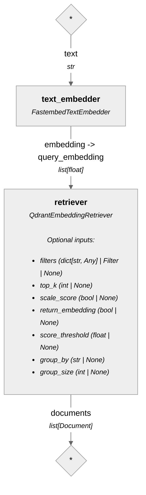
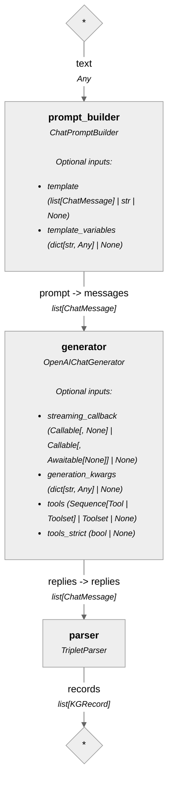
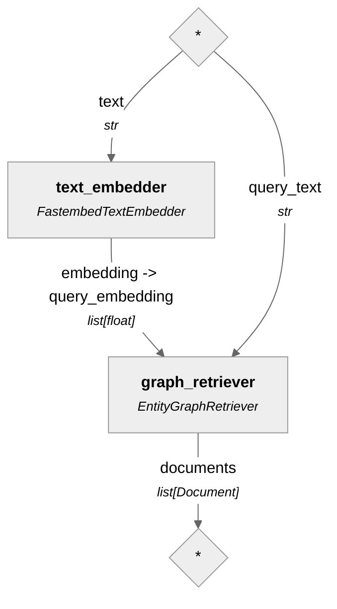
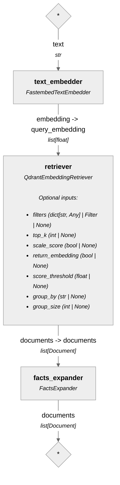

# Microservices Documentation RAG Assistant

A production-grade, self-contained local prototype of a microservices documentation RAG assistant built with **Python 3.14**, **Haystack**, **FastAPI**, **PostgreSQL**, **Qdrant**, **Neo4j**, **Taskiq**, **Streamlit**, and **multilingual-e5-small**.

---

## Architecture

```
Postgres                      = source of truth: Service + ServiceDocumentationChunk
                                rows (pure text), maintained by the worker.
docs_mock/*.md -> worker      = ATX-heading section splitter (Haystack
                                DocumentSplitter), SHA-256 hash-skip, chunk
                                upsert with NEW uuids on change.
Qdrant (doc_chunks)           = one point per chunk, point id = chunk UUID, so a
                                point joins to exactly one Postgres row and one
                                Neo4j Chunk node. Both derived stores can always
                                be rebuilt from Postgres.
Neo4j (knowledge graph)       = Chunk nodes + Entity nodes (typed labels,
                                384-dim embeddings) + typed relations, built
                                on demand from Postgres chunks (app/graph_rag).
/app/chat { retrieve_mode }   = vector | graph | hybrid | agent, dispatched
                                in app/query.py; all non-agent branches
                                share ONE LLM synthesis path.
```

Key decisions:

1. **One synthesis path, three retrieval branches (Haystack pipelines)**. `/chat` takes `retrieve_mode: "vector" | "graph" | "hybrid"`. Vector mode queries the Qdrant `doc_chunks` collection; graph mode retrieves through the Neo4j v2 graph — entities resolved by embedding similarity (native vector index) plus keyword hits, with no LLM in the retrieval loop; hybrid mode retrieves the same Qdrant chunks as vector mode and appends a `Graph facts` block (mentioned entities and their `X -> REL -> Y` semantic triplets) to each chunk's text. The three branches return Documents with identical metadata and score currency and share one synthesis path (`SearchResult -> build_context -> ChatPromptBuilder -> OpenAIChatGenerator`) in `app/query.py`, so a vector-vs-graph A/B never leaves that module. Mode selection lives entirely in `app/query.py`.
2. **Postgres is the source of truth for chunk text**. The worker persists every document and its chunks in PostgreSQL first; Qdrant and Neo4j are derived stores.
3. **Deterministic heading-section chunking**. The worker splits each markdown document into one section per ATX heading (`#` … `######`) via a Haystack `DocumentSplitter(split_by="function", ...)` with the `split_markdown_sections` function in `app/worker.py`. This reproduces the pre-Haystack `MarkdownNodeParser` segmentation byte-for-byte — verified 52/52 against the live chunk rows — so all existing vectors, graph nodes and eval baselines stay valid across the migration.
4. **Asymmetric E5 retrieval**: stored chunks are prefixed with `"passage: "`, user questions with `"query: "`. Prefixing happens once in `app/embeddings.py`, so every indexing and query path produces interchangeable vectors.
5. **Taskiq background worker**: a scheduler triggers every 60 seconds, scans `docs_mock/*.md`, computes SHA-256 hashes, re-splits changed documents, replaces their chunk rows in Postgres, drops the old points by the captured old chunk UUIDs and embeds/upserts the new ones into Qdrant.
6. **The knowledge graph is built separately from the vector index**: `uv run python -m app.graph_rag sync` does a full rebuild — it reads chunks from Postgres, extracts entities and relations with an LLM (strict JSON schema, max 8 triplets per chunk), writes Chunk/Entity nodes with MENTIONS edges `(e:Entity)-[:MENTIONS]->(c:Chunk)` and typed relations, and maintains the native `entity-embeddings` vector index on Entity nodes. The raw `neo4j` driver is used directly; retrieval degrades gracefully when the index or the server is unavailable.

### Real pipelines (generated from the Haystack pipeline graphs)

Vector retrieval (`app/vector_rag.build_retrieval_pipeline`):



Graph extraction (`app.graph_rag.build_extraction_pipeline`):



Graph retrieval (`app.graph_rag.build_graph_pipeline`):



Hybrid retrieval (`app.hybrid_rag.build_hybrid_pipeline`):



```
app/vector_rag.py — Qdrant rebuild + vector retrieval pipeline
app/graph_rag.py — Neo4j v2 graph build, extraction schema, graph retrieval
app/hybrid_rag.py — vector-first hybrid with MENTIONS fact expansion
app/agent_rag.py — pydantic-ai agent branch (tool loop + source mapping)
app/query.py — shared synthesis, retrieve_mode dispatch, /chat entry
```

### Agent retrieve mode

`retrieve_mode="agent"` swaps the fixed Haystack pipeline for a `pydantic-ai` tool loop (`app/agent_rag.py`): the model itself decides per step which read-only tool to call — `search_docs` (Qdrant retrieval via the same `app.vector_rag` factories), `graph_lookup` (Neo4j entities + triplets via `app.graph_rag`) or `read_chunk` (full chunk text from Postgres) — then writes the answer grounded in the tool output. Sources are mapped deterministically from the tool-call transcript (`read_chunk` call args, then `search_docs` result lines, deduped, capped at 5), never from the model's own "Sources:" line, so provenance is not hallucinated. The model endpoint is `LLM_API_BASE`/`LLM_MODEL` from `.env`; it must emit native tool calls — the local llama.cpp `Qwen2.5-Coder-1.5B` build does not (it answers or prints JSON instead of `tool_calls`), so point the agent runs at a tool-calling endpoint.

---

## Data Flows

**Ingestion — automatic, every 60 seconds (worker):**

```
docs_mock/*.md -> SHA-256 hash check -> ATX-heading sections -> PostgreSQL
               -> embed ("passage: " prefix) -> Qdrant upsert by chunk UUID
```

**Graph rebuild — manual, on demand:**

```
make sync -> read chunks from PostgreSQL -> LLM extraction (strict JSON schema)
          -> Neo4j full rebuild (Chunk/Entity nodes, MENTIONS + typed relations)
```

**Query — per request:**

```
Streamlit sidebar (vector | graph | hybrid) -> POST /chat { retrieve_mode }
-> Haystack pipeline (Qdrant, Neo4j graph, or both) -> shared LLM synthesis
-> answer + sources
```

---

## Quickstart Guide

### 1. Prerequisites
- **Python 3.14** (configured via `.python-version`)
- **[uv](https://docs.astral.sh/uv/)** package manager
- **Docker** (for PostgreSQL, Qdrant, and Neo4j via docker-compose)
- *(Optional)* **llama.cpp** running locally serving `Qwen/Qwen2.5-Coder-1.5B-Instruct-GGUF` at `http://127.0.0.1:8080/v1` (API key `ollama`), or any OpenAI-compatible API. Graph sync and answer synthesis both call the LLM, so one must be reachable for those steps.
Copy `.env.example` to `.env` and fill in `LLM_API_KEY` when using an external OpenAI-compatible provider; `.env` is gitignored, so secrets never enter commits.

### 2. Environment Configuration
Create a `.env` file from `.env.example` (`make env` does this for you) and set the infrastructure URLs/credentials. The defaults in `app/config.py` target localhost: Postgres on 5432, Qdrant on 6333 (collection `doc_chunks`), Neo4j on bolt `localhost:7687`, local llama.cpp as the LLM, and the FastAPI backend at `http://localhost:8000`. Secrets live only in `.env` — never in this file or in commits.

### 3. Run Tests
Run the full test suite via `make test` — it starts the infrastructure automatically first (`test` depends on `up`, so `docker compose up -d` runs before pytest):
```bash
make test
```
`make lint` runs ruff, `make typecheck` runs ty — both are part of the dev extras.

### 4. Running the Services

All services are started through the Makefile (`make help` lists every target). `docker compose` only provides the infrastructure layer (PostgreSQL, Qdrant, Neo4j); the app processes run locally via `uv`. Workflow order:

1. *(Optional)* **Create the environment file** — copies `.env.example` to `.env` only if `.env` does not exist yet:
   ```bash
   make env
   ```
2. **Start the infrastructure** (PostgreSQL, Qdrant, Neo4j):
   ```bash
   make up
   ```
3. **Start the Taskiq worker** (syncs and embeds markdown docs every 60 seconds):
   ```bash
   make worker
   ```
4. **Build the knowledge graph** (manual, see below; requires a reachable LLM):
   ```bash
   make sync
   ```
5. **Start the FastAPI backend**:
   ```bash
   make backend
   ```
6. **Start the Streamlit chat UI** (run in a separate terminal):
   ```bash
   make frontend
   ```

- **Streamlit Chat UI**: [http://localhost:8501](http://localhost:8501)
- **FastAPI Docs**: [http://localhost:8000/docs](http://localhost:8000/docs)

`make ps` shows infrastructure container status and `make down` stops them.

### 5. Building the Knowledge Graph
Vector search works as soon as the worker has indexed the docs. The graph branch needs one explicit build step, which fully rebuilds the Neo4j graph from the chunks stored in Postgres using LLM-based extraction:
```bash
make sync
```
Re-run it whenever documentation changes materially; it wipes and rebuilds the graph in place. `make vector-sync` rebuilds the Qdrant index from Postgres the same way, which is usually unnecessary — the worker does it automatically.

### 6. Backing up and restoring Neo4j

Backing up the extracted graph protects it from an accidental wipe: a backup can always be restored without re-running the expensive LLM extraction sync. The Neo4j container is stopped for a few seconds during either operation and restarted automatically (PostgreSQL and Qdrant stay up):

```bash
make backup
make restore BACKUP=backups/neo4j_<timestamp>.tar.gz
```

`backup` archives the Neo4j `/data` directory to a timestamped compressed file in `backups/`; `restore` deletes the current graph data and extracts the archive in its place.

---

## Migration history

The service was originally built on LlamaIndex (chunk parsing, ingestion pipeline, PropertyGraphIndex and response synthesizer). Waves 1-4 replaced it with Haystack end-to-end without changing observable behavior: vector retrieval and indexing (wave 1), Neo4j graph build and graph retrieval with the raw neo4j driver (wave 2), hybrid facts expansion and the shared synthesis dispatcher (wave 3), and the ingestion worker with a byte-compatible heading-section splitter (wave 4). The `docs_mock` chunking invariant — splitter output equals the pre-migration Postgres chunk rows byte-for-byte — is checked after every splitter change. No LlamaIndex code remains in `app/`.